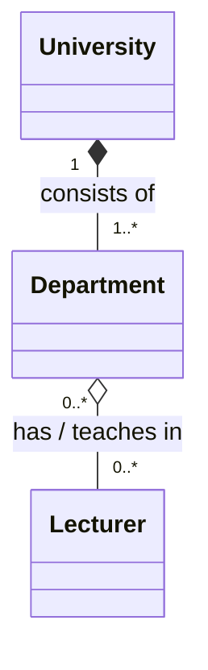
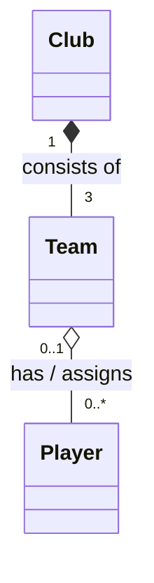
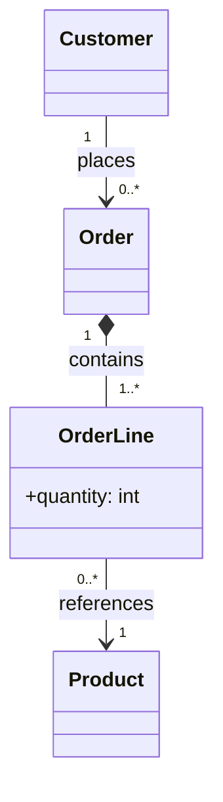

# OOP 2 — Complete Answers

These answers follow the supplied `OOP2_Exercises.md`.

## Exercise 1 — The Bank

The complete Java implementation is in `Exercise1_Bank/src/`:

- `Account.java` — abstract superclass with private holder and balance, validated constructor, concrete `deposit()` and `printSummary()`, and abstract `processMonth()`.
- `SavingsAccount.java` — adds 2% interest when configured with rate `0.02`.
- `CheckingAccount.java` — deducts the configured monthly fee.
- `LoanAccount.java` — adds interest to the outstanding debt.
- `Bank.java` — stores a `List<Account>` and processes every account without checking its concrete class.
- `App.java` — creates Lexicon Bank, adds the three requested account types, and prints before-and-after balances.

`Account` uses a protected `adjustBalance(double)` helper. This allows subclasses to update the private balance without exposing it publicly or permitting negative deposits.

### Expected starting and ending balances

| Account type | Starting balance | Month-end change | Ending balance |
|---|---:|---:|---:|
| Savings (Ali) | 1,000.00 kr | +20.00 kr (2%) | 1,020.00 kr |
| Checking (Sara) | 500.00 kr | -25.00 kr | 475.00 kr |
| Loan (Omar) | 5,000.00 kr | +150.00 kr (3%) | 5,150.00 kr |

### Think: How does Java know which `processMonth()` to run?

**Runtime polymorphism / dynamic method dispatch:** Each element of `List<Account>` is an `Account` reference, but Java executes the overridden `processMonth()` method belonging to the actual object (`SavingsAccount`, `CheckingAccount` or `LoanAccount`). The loop does not need `instanceof` or `if` statements.

`new Account("Ali", 1000)` is invalid because **`Account` is abstract**. Abstract classes cannot be instantiated directly, and the abstract `processMonth()` must be implemented by a concrete subclass.

## Exercise 2 — University Departments

- **University–Department: composition (`*--`).** Each Department belongs to exactly **1 University**, and the University has **1 or more Departments**. Departments cannot exist independently of the university in this problem.
- **Department–Lecturer: shared aggregation (`o--`).** A Department can have **0 or more Lecturers**; a Lecturer can be linked to **0 or more Departments**, allowing teaching across departments and temporary reassignment. Lecturers continue to exist if a department closes.

The filled diamond belongs on the University end. The hollow diamond belongs on the Department end.

## Exercise 3 — Sports Club

- **Club–Team: composition (`*--`).** Every Team belongs to exactly **1 Club**. The scenario specifies exactly **3 Teams** (first, reserve and youth). Teams cease to exist if their club closes.
- **Team–Player: shared aggregation (`o--`).** A Team has **0 or more Players**. A Player belongs to **0 or 1 Team at a time**; zero permits a player to remain registered but unassigned during a transfer or after a team is dissolved. The player exists independently of any specific team.

The filled diamond belongs on the Club end. The hollow diamond belongs on the Team end.

## Exercise 4 — Customer Orders

- **Order–OrderLine: composition (`*--`).** An Order contains **1 or more OrderLines**; each OrderLine belongs to exactly **1 Order** and cannot survive deletion of that order.
- **OrderLine–Product: association (`-->`).** An OrderLine references exactly **1 Product**, while the same Product may appear in **0 or more OrderLines**. Deleting an order line does not delete the catalog Product.
- **Customer–Order: association (`-->`).** A Customer may place **0 or more Orders**. Each Order belongs to exactly **1 Customer**. A simple association is appropriate because the exercise establishes a placing relationship, not lifecycle-dependent ownership.

The arrows on associations indicate navigability, not ownership. Filled diamonds indicate composition; hollow diamonds indicate aggregation.
