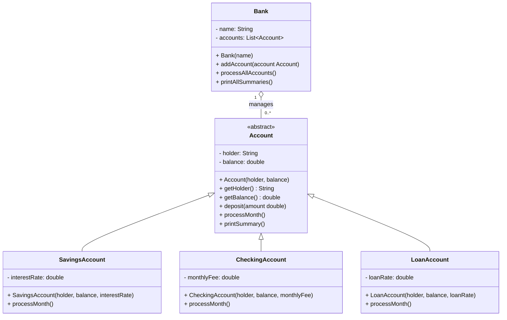

# Exercise 1 — The Bank

## UML class diagram

**Relationships:** `Account` is an abstract superclass; the three account types inherit from it. `Bank` aggregates `Account` objects that can exist independently of the bank.
