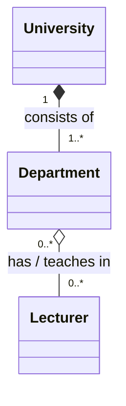

# Exercise 2 — University Departments

## UML class diagram

**Explanation:** Composition (`*--`) connects the university and its departments, because each department depends on the university. Aggregation (`o--`) connects departments and lecturers, who can be reassigned.

See `../Answers.md` for multiplicity and relationship reasoning.
