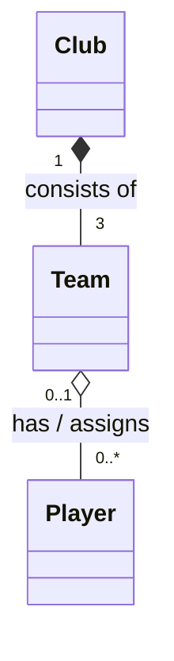

# Exercise 3 — Sports Club

## UML class diagram

**Explanation:** Composition (`*--`) connects club and teams, whose lifetimes depend on the club. Aggregation (`o--`) connects teams and players, who survive team dissolution or transfer.

See `../Answers.md` for multiplicity and relationship reasoning.
