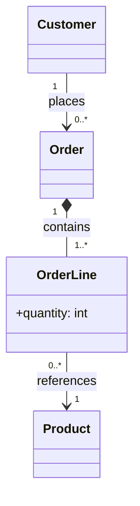

# Exercise 4 — Customer Orders

## UML class diagram

**Explanation:** Composition (`*--`) connects orders to order lines. Associations (`-->`) link order lines to catalog products and customers to orders.

See `../Answers.md` for multiplicity and relationship reasoning.
