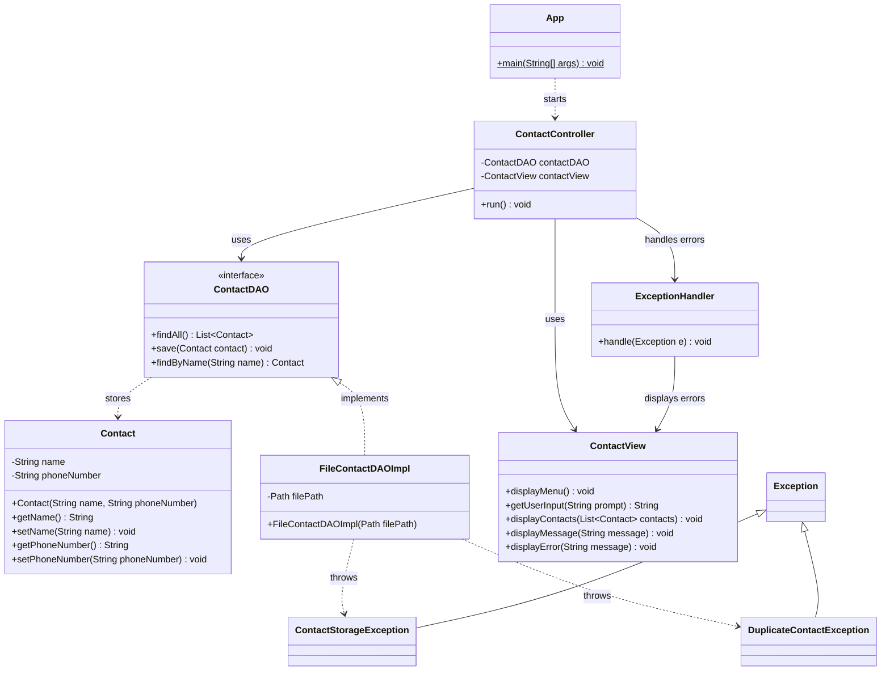

# Contact App Workshop

A Java 25 Maven console application for managing contacts in a text file. Built for the Lexicon exception-handling workshop using the MVC pattern.

## Features

- Add, list, and search for contacts by name.
- Validate names and 10-digit phone numbers with `IllegalArgumentException`.
- Prevent duplicate names using `DuplicateContactException` (checked).
- Handle file problems using `ContactStorageException` (checked).
- Save contacts in `data/contacts.txt` using try-with-resources.
- Keep user interaction in the View and errors in a centralized `ExceptionHandler`.

## UML class diagram



**MVC:** `Contact` is the model; `ContactView` handles console input/output; `ContactController` coordinates actions; `ContactDAO` and `FileContactDAOImpl` handle persistence. Invalid model data throws an unchecked `IllegalArgumentException`; file and duplicate errors use checked exceptions.

## Build and run

Requirements: **JDK 25** and **Maven 3.9+**.

From the `contact-workshop` folder:

```bash
mvn clean test
mvn package
java -cp target/classes se.lexicon.App
```

To choose a different contacts file:

```bash
java -cp target/classes se.lexicon.App contacts.txt
```

The default data file (`data/contacts.txt`) is created when you save your first contact and is excluded from Git.
