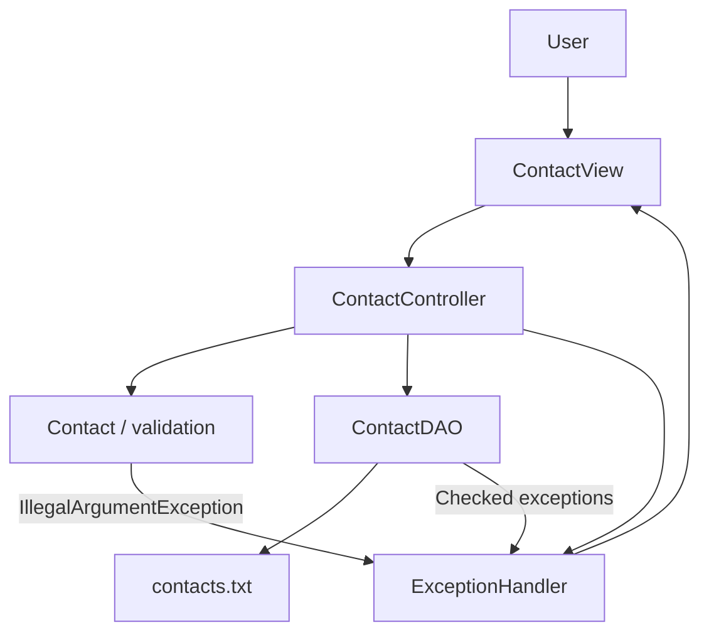

# Contact App Workshop — Java Exceptions & MVC

A complete solution to the [Lexicon Exception Workshop](Exception_Workshop.md): a Java 17 console application that saves contacts to a UTF-8 text file.

**Maven coordinates:** `se.lexicon:contact-app-workshop:1.0-SNAPSHOT`

## Requirements

- Java Development Kit **17 or newer**
- Apache Maven **3.8+** (for the standard build and JUnit tests)

## Run

Open a terminal **inside `contact-workshop/`**:

```bash
mvn clean test
mvn package
java -cp target/classes se.lexicon.App
```

On first save, the app creates `data/contacts.txt`. The data directory is ignored by Git.

To use a different text file (also useful for testing), pass its path:

```bash
java -cp target/classes se.lexicon.App my-contacts.txt
```

Example session:

```text
=== Contact App ===
1. List all contacts
2. Add a contact
3. Find contact by name
0. Exit
Choose an option: 2
Name: Anna
Phone number (10 digits): 0123456789
Contact saved successfully.
```

## Features

1. **List all contacts** from the text file, or display an empty-state message.
2. **Add a contact** after validating its name and phone number.
3. **Find by name**, ignoring letter case and surrounding spaces.
4. **Prevent duplicates:** two stored contacts cannot have the same name (case-insensitive).
5. **Handle failures gracefully:** invalid input, duplicate names, malformed files, and file IO failures do not crash the menu.
6. **Quit** using `0` or end-of-input.

Phone numbers must be **exactly 10 ASCII digits** (`[0-9]{10}`), as specified in the exercise. The program does not accept `+46`, spaces, or hyphens. Names must be nonblank and cannot contain tabs or newlines. Commas and international characters in names are supported.

## Project structure

```text
contact-workshop/
├── pom.xml
├── README.md
├── Exception_Workshop.md
├── .gitignore
└── src/
    ├── main/java/se/lexicon/
    │   ├── App.java
    │   ├── model/Contact.java
    │   ├── data/ContactDAO.java
    │   ├── data/FileContactDAOImpl.java
    │   ├── view/ContactView.java
    │   ├── controller/ContactController.java
    │   └── exception/
    │       ├── ContactStorageException.java
    │       ├── DuplicateContactException.java
    │       └── ExceptionHandler.java
    └── test/java/se/lexicon/
        ├── model/ContactTest.java
        ├── data/FileContactDAOImplTest.java
        └── controller/ContactControllerTest.java
```

## MVC explained (workshop question 5)

**MVC** means **Model–View–Controller**. It separates the application into components with distinct responsibilities:

- **Model:** `Contact` represents and validates a contact. Its setter/constructor methods throw `IllegalArgumentException`, an **unchecked** exception, when data is invalid.
- **View:** `ContactView` handles all user interaction, including `Scanner` input, displaying menus, contacts, and errors. No other layer writes to the console.
- **Controller:** `ContactController` reads user choices, creates `Contact` objects, asks the DAO to save/read them, and delegates exceptions to `ExceptionHandler`.
- **Data (DAO):** `ContactDAO` defines persistence operations; `FileContactDAOImpl` implements them using a text file and **try-with-resources** for automatically closing the reader/writer.
- **Exception layer:** `DuplicateContactException` and `ContactStorageException` extend `Exception` and are therefore **checked**; callers must catch or declare them. `ExceptionHandler` converts all application errors into friendly View messages.

### Request and exception flow



For example, when the user saves a contact, the controller creates a `Contact` (which validates the input). The controller then calls `ContactDAO.save`. The DAO checks for duplicate names and appends a valid contact to the file. A failed operation throws an exception back to the controller; the centralized handler tells the View what error message to show. This separation makes validation and persistence independently testable.

## File format and error behavior

Stored records look like:

```text
Anna\t0123456789
Noah\t0987654321
```

`\t` in the example above represents a **literal tab character** between the two fields; each contact is on its own line. The file uses UTF-8. A missing file means the contact list is empty. An unreadable file, invalid saved record, or duplicate name in the stored data raises `ContactStorageException`. A new duplicate name raises `DuplicateContactException` **before** any write occurs.

## Automated tests

```bash
mvn test
```

JUnit 5 tests check validation, Unicode names, save/reload, missing files, case-insensitive duplicate detection and lookup, malformed saved data, IO failures, controller navigation, error recovery, and end-of-input.

## Add this folder to `jackaldzn-blip/lexicon-work`

The repository's root `.gitignore` already whitelists `contact-workshop/`.

1. Extract the ZIP **into your existing `lexicon-work` folder** so `lexicon-work/contact-workshop/pom.xml` exists (do not extract into `exception-exercises/`).
2. From the **repository root**, run:

   ```bash
   git add contact-workshop
   git commit -m "Add completed Contact App exception workshop"
   git push origin main
   ```

3. Submit: `https://github.com/jackaldzn-blip/lexicon-work/tree/main/contact-workshop`

**Important:** This ZIP is a subproject to add to an existing repository; it does not contain or replace the repository's `.git` folder or its existing exercises.
