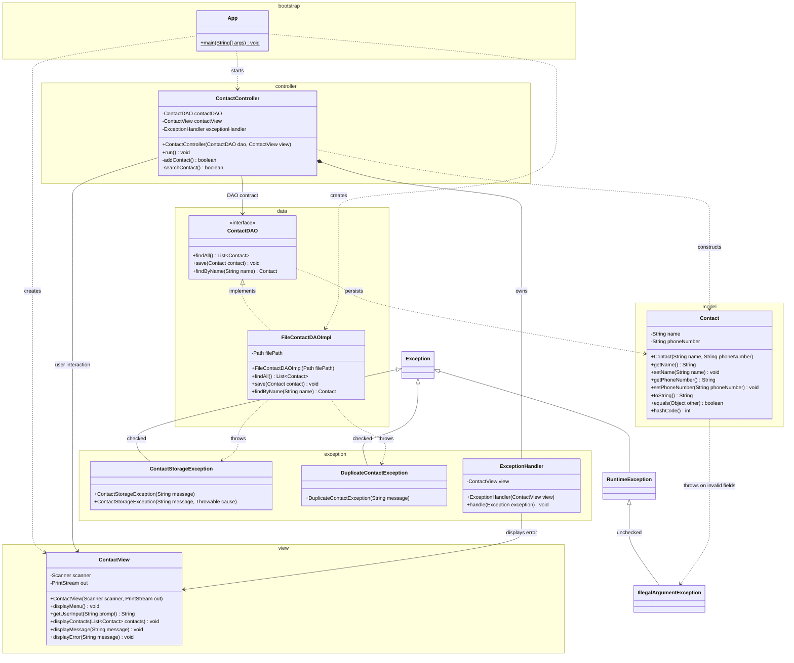
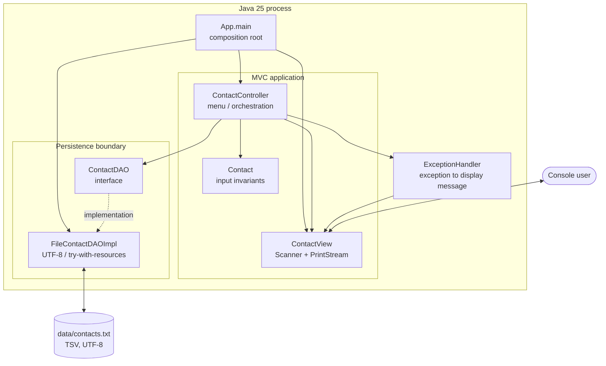
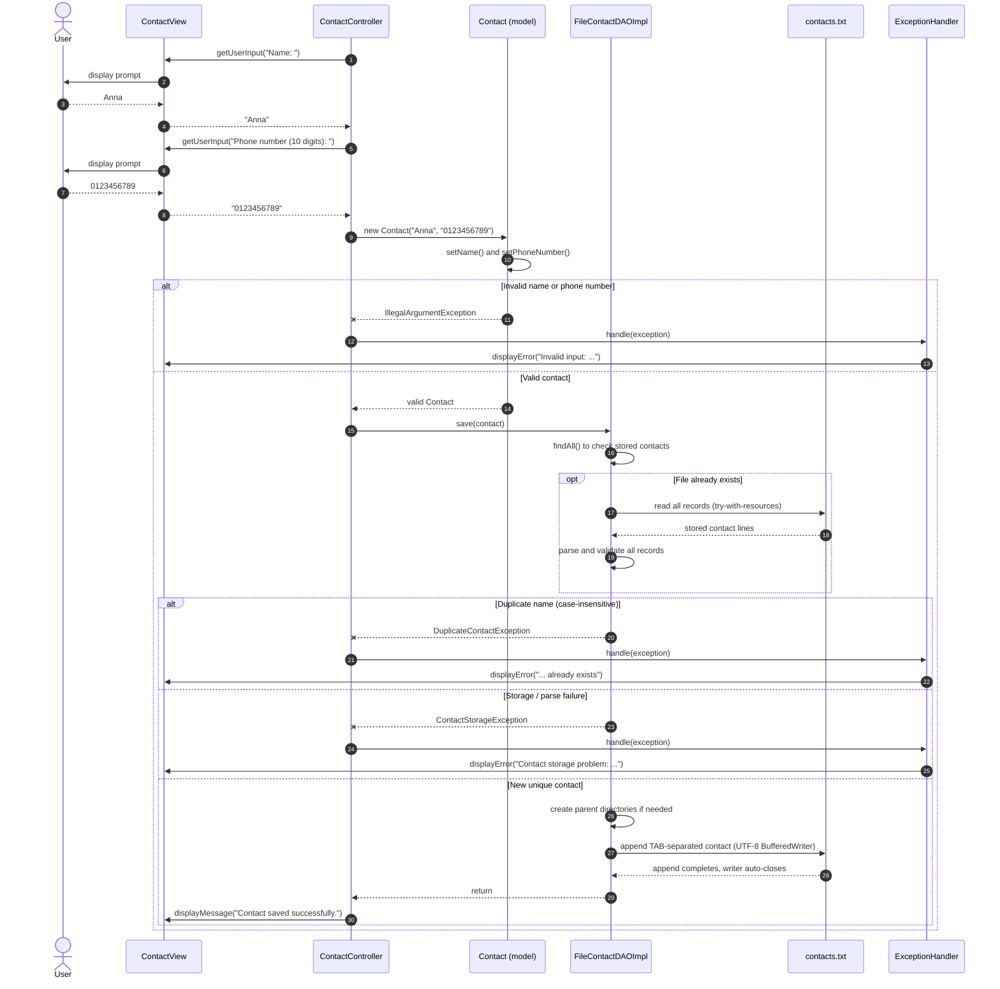
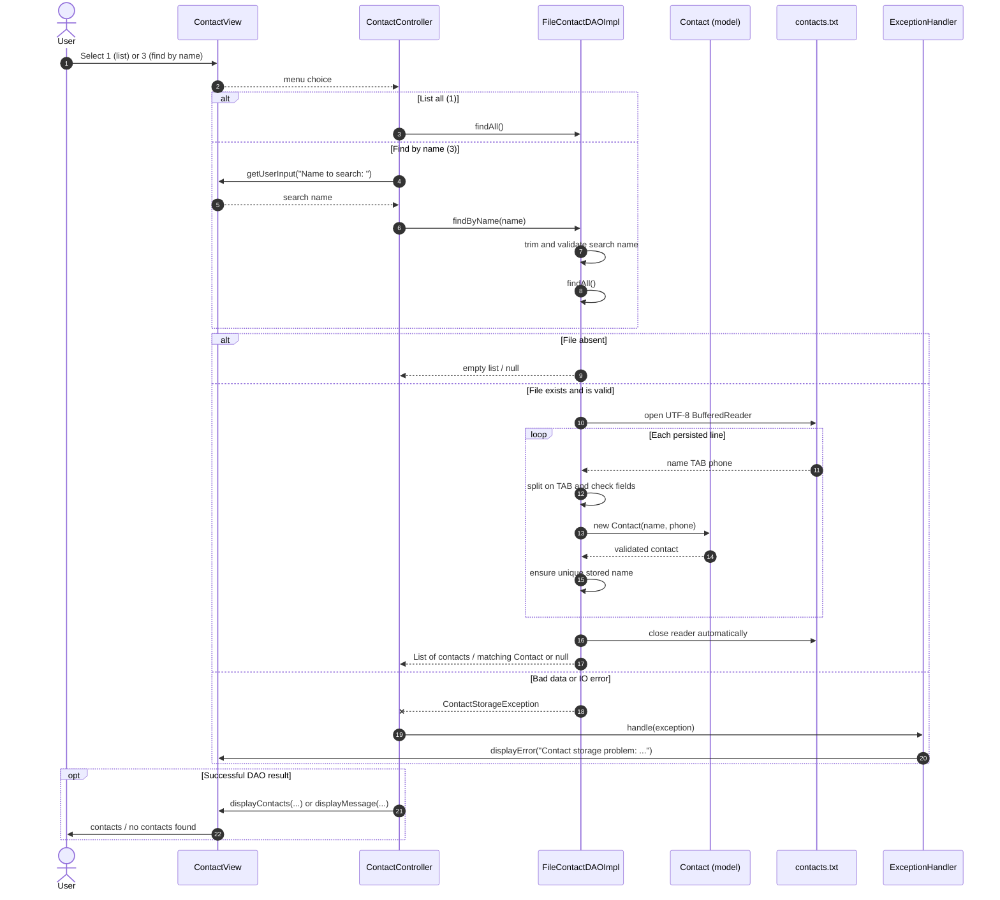
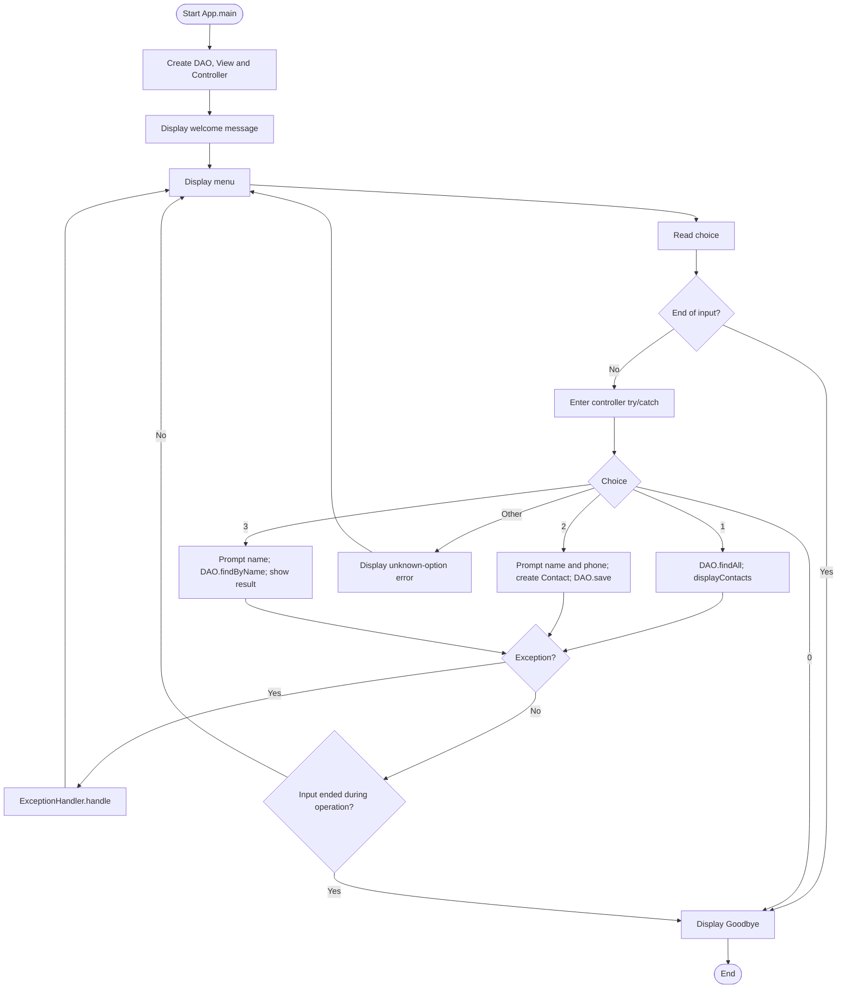
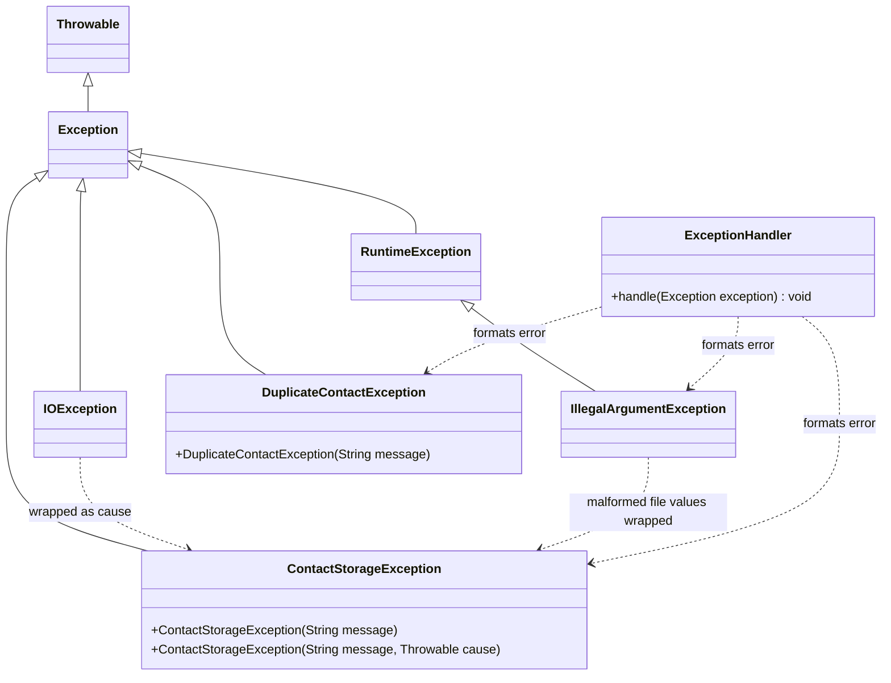
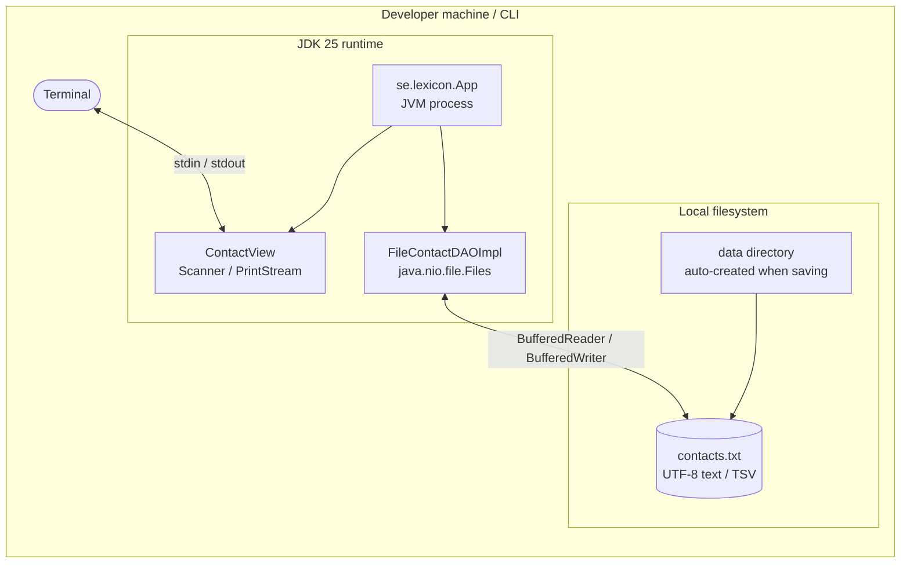

# Technical UML and architecture — Contact App Workshop

> **Java 25** | `se.lexicon:contact-app-workshop` | MVC + DAO + checked/unchecked exceptions | file-based persistence

This document diagrams the **actual implementation** in `src/main/java/se/lexicon`, rather than only the simplified conceptual class diagram supplied by the workshop. All seven diagrams below use **Mermaid** code blocks that render directly in GitHub Markdown. Each also has a matching editable `.mmd` source file in this directory. No exported images or alternative diagram languages are included.

## Source-of-truth and notation

- UML class and sequence diagrams use Mermaid's UML syntax. Component, activity, and deployment views use **Mermaid flowcharts** to document those UML concepts and are labeled as such; they are not strict UML 2.x element/connector notation.
- `ContactController` owns an `ExceptionHandler` instance. `ExceptionHandler.handle(Exception)` is **not static**.
- Java uses `Path` for file locations, UTF-8 text, and `BufferedReader`/`BufferedWriter` in try-with-resources. A missing file is an empty contact book.
- The application is **single-process**; there is no concurrency coordination or transactional storage. This is deliberate workshop scope; concurrent saves by independent processes are not synchronized.

## 1. Detailed UML class diagram

Exact types, fields, constructors, public/private operations, interface realization, dependencies, and exception hierarchy. `+` is public, `-` is private, and `<|..` means interface realization. Methods with `void` return types are shown explicitly; exception declarations are in the contract table below.



## 2. Component and package architecture

Package-level view of the composition root and runtime dependencies. The diagram is a Mermaid flowchart representation of a component diagram: data persistence sits behind the DAO contract and only the View interacts with the terminal.



## 3. UML sequence: add contact (including failures)

Follow the add action from prompts and validation through duplicate checking and UTF-8 append. The alternative branches cover the three principal outcomes: invalid input, duplicate record, and a storage failure.



## 4. UML sequence: list and find contacts

Both list and search call into the same `findAll()` loader. `findByName()` performs its own query validation, then iterates over loaded contacts. A missing file is treated as empty storage; corrupt data is not.



## 5. Controller activity and menu loop

An activity-style flowchart showing decisions, recovery from exceptions, and the exit conditions. The `try/catch` covers each selected menu action; exceptions are presented via the central handler and control returns to the menu.



## 6. UML exception hierarchy

Unchecked `IllegalArgumentException` comes from `RuntimeException`. Both workshop-specific exceptions derive directly from `Exception` (checked). IO errors and invalid persisted records are wrapped in `ContactStorageException`.



## 7. Runtime deployment and file persistence

A deployment-style flowchart for a single JVM process on a developer computer. No web server or database is involved. The relative path is resolved against the process working directory.



## 8. Public interface and exception contract

| Declaring type | Operation | Return | Checked exceptions | Unchecked validation/errors |
|---|---|---|---|---|
| `Contact` | `Contact(name, phoneNumber)` | instance | — | `IllegalArgumentException` for invalid name or phone |
| `Contact` | `setName(name)` | `void` | — | `IllegalArgumentException` for null/blank, TAB, CR or LF |
| `Contact` | `setPhoneNumber(phone)` | `void` | — | `IllegalArgumentException` unless exactly 10 ASCII digits |
| `ContactDAO` | `findAll()` | `List<Contact>` | `ContactStorageException` | — |
| `ContactDAO` | `save(contact)` | `void` | `ContactStorageException`, `DuplicateContactException` | `NullPointerException` for null contact |
| `ContactDAO` | `findByName(name)` | `Contact` or `null` | `ContactStorageException` | `IllegalArgumentException` for null/blank search |
| `ContactView` | `getUserInput(prompt)` | `String` or `null` on EOF | — | — |
| `ExceptionHandler` | `handle(exception)` | `void` | — | — |
| `ContactController` | `run()` | `void` | None leak from the loop's `catch (Exception)` | Error is shown, menu remains active |

In Java 25, exceptions' **checked or unchecked nature does not change**: a class extending `Exception` directly is checked; `IllegalArgumentException` extends `RuntimeException` and is unchecked.

## 9. File format and integrity rules

### Storage layout

```text
data/
  contacts.txt      # created on first successful save
```

Example file (the whitespace between name and number is one literal TAB):

```text
Anna	0123456789
Åsa, Björn	0987654321
```

| Concern | Behavior in implementation |
|---|---|
| Encoding | UTF-8 for both reading and writing |
| Record delimiter | One contact per line (line ending from OS when appended) |
| Field delimiter | Exactly one TAB; two fields required |
| Name validation | Must not be null/blank; trimmed; must not contain tab, carriage return or newline |
| Phone validation | `[0-9]{10}` (exactly ten ASCII digits) |
| Duplicate identity | Name compared ignoring case; phone numbers are **not** uniqueness keys |
| New file | Missing storage file is treated as an empty contact list |
| Corrupted record | `ContactStorageException`, with line number and original cause when available |
| Existing duplicates | `ContactStorageException` while loading the file |
| Write strategy | `CREATE + APPEND`; parent directories created before writing |
| Resource cleanup | `BufferedReader` and `BufferedWriter` automatically closed via try-with-resources |
| Important limitation | Append is not a concurrent multi-process transaction; no file locking or atomic rewrite |

## 10. Design decisions and traceability

| Requirement from Lexicon workshop | Implementation | Verification |
|---|---|---|
| MVC pattern | `model`, `view`, `controller` packages, `App` composition root | `ContactControllerTest` |
| Unchecked validation | `Contact.setName`, `Contact.setPhoneNumber` | `ContactTest` |
| Custom checked exceptions | `ContactStorageException`, `DuplicateContactException` | `FileContactDAOImplTest` |
| DAO decoupling | `ContactDAO` interface, `FileContactDAOImpl` | `FileContactDAOImplTest` |
| Try-with-resources | `FileContactDAOImpl.findAll` and `save` | `FileContactDAOImplTest` (including file errors) |
| Centralized exception handler | `ExceptionHandler.handle` called from controller's try/catch | `ContactControllerTest` |
| Clear bootstrapping | `App.main` constructs DAO, View, Controller | Manual console run |

### Package boundaries

- `model` knows no console, persistence, or controller dependencies.
- `data` knows `model` and checked exceptions; it never prints to the terminal.
- `view` knows only `model`, `java.util.Scanner`, and `java.io.PrintStream`.
- `controller` coordinates the View, Model and DAO, delegating error presentation.
- `exception.ExceptionHandler` maps exceptions into View messages without swallowing `Error` subclasses.
- `App` is the **composition root**; it wires the interfaces and starts the program.

### Notes for extensions (not implemented)

For production use, common extensions would include atomic write/replace, file locking, structured data storage, stable record identifiers, and international telephone validation. These are **not requirements** of this workshop and are intentionally not represented as implemented features in the UML.

## 11. Where to inspect the diagrams

- **GitHub preview:** open [`technical-uml.md`](technical-uml.md) for all seven Mermaid diagrams, or [`README.md`](../../README.md) for the class diagram.
- **Editable sources:** the seven [`*.mmd`](./) files in this folder. These are plain-text Mermaid sources.
- **Editing:** use a `mermaid` fenced code block in Markdown for GitHub rendering; update the corresponding `.mmd` source when changing a diagram.
- **Original conceptual model:** [`Exception_Workshop.md`](../../Exception_Workshop.md).
