# ConverterApp — Program Flowchart and Logic

## Overview

`ConverterApp` is a menu-driven Java console application. It offers three features:

1. **Temperature conversion:** Celsius to Fahrenheit or Fahrenheit to Celsius.
2. **Currency conversion:** Swedish kronor (SEK) to US dollars (USD) or euros (EUR).
3. **BMI calculation:** Calculate body mass index (BMI) from weight and height and display the BMI category.

The user can return to the main menu after completing an operation or exit the application.

## Key Program Concepts

### 1. Main Loop

The main `while (true)` loop keeps the application running and displays the menu again when the user chooses to continue. It stops only when the user selects **option 4 (Exit)** or answers **no** to the continue question.

### 2. Input Validation

Both `readChoice()` and `readNumber()` use their own `while (true)` loops to re-prompt for invalid input. When the user enters an invalid value, **only that input is requested again**; the entire application does not restart.

The feature-specific checks include:

- **Temperature:** The selected conversion direction must be valid, and the entered temperature must not be below absolute zero in its source unit.
- **Currency:** The selected conversion direction must be valid, and the SEK amount must be nonnegative.
- **BMI:** Both weight and height must be greater than zero.
- **Continue prompt:** Invalid answers are requested again until the user enters an accepted response.

### 3. Methods and Separation of Responsibilities

Each feature uses a method that manages the interaction with the user and a separate method that performs the calculation and returns a result.

| Method | Responsibility |
| --- | --- |
| `showMenu()` | Display the available menu options. |
| `readChoice()` | Read and validate a menu or direction choice. |
| `readNumber()` | Read a valid numeric input; feature-specific bounds are checked in the calling flow. |
| `showTemperatureConverter()` | Guide the user through the temperature conversion. |
| `convertTemperature()` | Calculate and return the converted temperature. |
| `showCurrencyConverter()` | Guide the user through the currency conversion. |
| `convertCurrency()` | Calculate and return the converted amount. |
| `showBmiCalculator()` | Guide the user through BMI inputs and output. |
| `calculateBmi()` | Calculate and return BMI. |
| `getBmiCategory()` | Return the category corresponding to the calculated BMI. |
| `askToContinue()` | Ask whether to return to the main menu. |

## Application Flowchart

```mermaid
%%{init: {"theme":"base","flowchart":{"curve":"rounded","padding":12}}}%%
flowchart TB
  n1(["START"])
  n2["Create Scanner"]
  n3["while (true)<br/>showMenu()"]
  n4["readChoice()<br/>Enter option 1–4"]
  n5{"Valid menu<br/>choice?"}
  n6{"Which option?"}
  n7["showTemperatureConverter()"]
  n8["Choose direction<br/>1. C to F<br/>2. F to C"]
  n9{"Valid direction?"}
  n10["readNumber()<br/>Enter temperature"]
  n11{"Valid number and<br/>above absolute zero?"}
  n12["convertTemperature()"]
  n13["Display temperature result"]
  n14["showCurrencyConverter()"]
  n15["Choose direction<br/>1. SEK to USD<br/>2. SEK to EUR"]
  n16{"Valid direction?"}
  n17["readNumber()<br/>Enter SEK amount"]
  n18{"Valid number<br/>and nonnegative?"}
  n19["convertCurrency()"]
  n20["Display currency result"]
  n21["showBmiCalculator()"]
  n22["readNumber()<br/>Enter weight"]
  n23{"Valid weight<br/>greater than 0?"}
  n24["readNumber()<br/>Enter height"]
  n25{"Valid height<br/>greater than 0?"}
  n26["calculateBmi()"]
  n27["getBmiCategory()"]
  n28["Display BMI and category"]
  n29["askToContinue()"]
  n30{"Answer?"}
  n31["break"]
  n32["Print Goodbye!<br/>Close Scanner"]
  n33(["END"])
  n1 --> n2
  n2 --> n3
  n3 --> n4
  n4 --> n5
  n5 -->|No| n4
  n5 -->|Yes| n6
  n6 -->|1| n7
  n7 --> n8
  n8 --> n9
  n9 -->|No| n8
  n9 -->|Yes| n10
  n10 --> n11
  n11 -->|No| n10
  n11 -->|Yes| n12
  n12 --> n13
  n6 -->|2| n14
  n14 --> n15
  n15 --> n16
  n16 -->|No| n15
  n16 -->|Yes| n17
  n17 --> n18
  n18 -->|No| n17
  n18 -->|Yes| n19
  n19 --> n20
  n6 -->|3| n21
  n21 --> n22
  n22 --> n23
  n23 -->|No| n22
  n23 -->|Yes| n24
  n24 --> n25
  n25 -->|No| n24
  n25 -->|Yes| n26
  n26 --> n27
  n27 --> n28
  n13 --> n29
  n20 --> n29
  n28 --> n29
  n29 --> n30
  n30 -->|Invalid| n29
  n30 -->|Yes| n3
  n6 -->|4| n31
  n30 -->|No| n31
  n31 --> n32
  n32 --> n33

  classDef ds1 fill:#f0fdf4,stroke:#4ade80,color:#000000
  classDef ds2 fill:#f8fafc,stroke:#94a3b8,color:#000000
  classDef ds3 fill:#fffbeb,stroke:#fbbf24,color:#78350f
  classDef ds4 fill:#f8fafc,stroke:#94a3b8,color:#172033
  classDef ds5 fill:#f0fdf4,stroke:#4ade80,color:#17325c
  class n1 ds1
  class n2,n3,n4 ds2
  class n5,n6,n9,n11,n16,n18,n23,n25,n30 ds3
  class n7,n8,n10,n12,n13,n14,n15,n17,n19,n20,n21,n22,n24,n26,n27,n28,n29,n31,n32 ds4
  class n33 ds5
  linkStyle 0 stroke:#6b778d
  linkStyle 1 stroke:#6b778d
  linkStyle 2 stroke:#6b778d
  linkStyle 3 stroke:#6b778d
  linkStyle 4 stroke:#6b778d
  linkStyle 5 stroke:#6b778d
  linkStyle 6 stroke:#6b778d
  linkStyle 7 stroke:#6b778d
  linkStyle 8 stroke:#6b778d
  linkStyle 9 stroke:#6b778d
  linkStyle 10 stroke:#6b778d
  linkStyle 11 stroke:#6b778d
  linkStyle 12 stroke:#6b778d
  linkStyle 13 stroke:#6b778d
  linkStyle 14 stroke:#6b778d
  linkStyle 15 stroke:#6b778d
  linkStyle 16 stroke:#6b778d
  linkStyle 17 stroke:#6b778d
  linkStyle 18 stroke:#6b778d
  linkStyle 19 stroke:#6b778d
  linkStyle 20 stroke:#6b778d
  linkStyle 21 stroke:#6b778d
  linkStyle 22 stroke:#6b778d
  linkStyle 23 stroke:#6b778d
  linkStyle 24 stroke:#6b778d
  linkStyle 25 stroke:#6b778d
  linkStyle 26 stroke:#6b778d
  linkStyle 27 stroke:#6b778d
  linkStyle 28 stroke:#6b778d
  linkStyle 29 stroke:#6b778d
  linkStyle 30 stroke:#6b778d
  linkStyle 31 stroke:#6b778d
  linkStyle 32 stroke:#6b778d
  linkStyle 33 stroke:#6b778d
  linkStyle 34 stroke:#6b778d
  linkStyle 35 stroke:#6b778d
  linkStyle 36 stroke:#6b778d
  linkStyle 37 stroke:#6b778d
  linkStyle 38 stroke:#6b778d
  linkStyle 39 stroke:#6b778d
  linkStyle 40 stroke:#6b778d
  linkStyle 41 stroke:#6b778d
  linkStyle 42 stroke:#6b778d
  linkStyle 43 stroke:#6b778d
```

## Reading the Flowchart

- **Rectangles** represent operations, method calls, and output.
- **Diamonds** represent choices or validation decisions.
- **Arrows back to an input** show that only the invalid input is retried.
- **Arrows to `askToContinue()`** connect the three completed operations to a common continue/exit decision.
- **`break`** exits the main loop, after which the application prints `Goodbye!`, closes its `Scanner`, and ends.