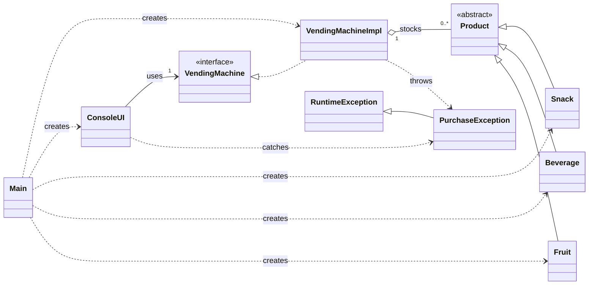
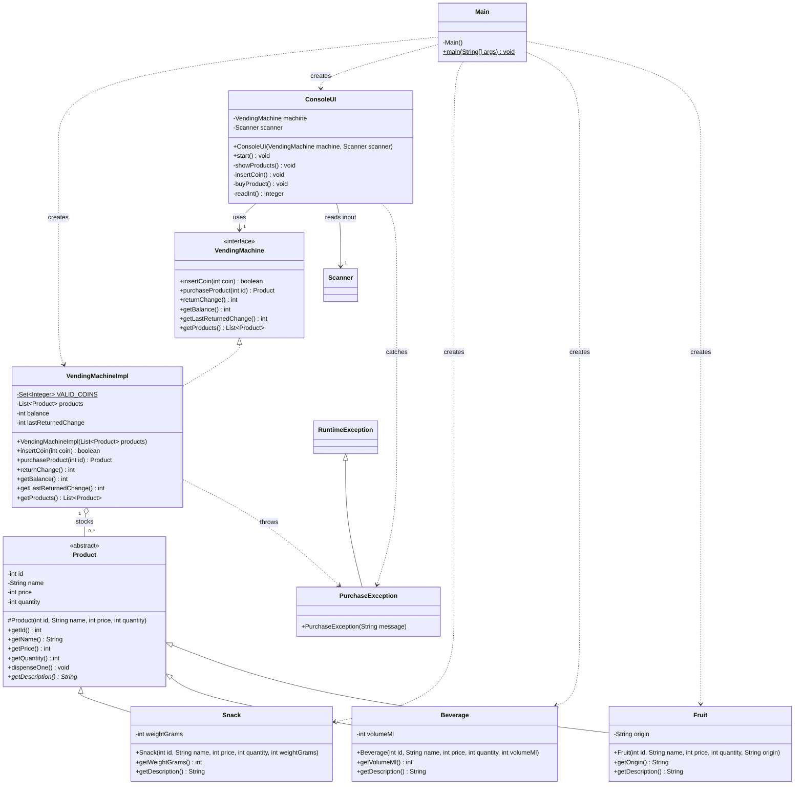

# Lexicon OOP Workshop — Vending Machine

A Java console application for the Lexicon object-oriented programming workshop. Java 17+ and Maven are recommended.

## Run the included executable JAR

```bash
java -jar vending-machine.jar
```

## Build and test with Maven

```bash
mvn clean test
mvn package
java -jar target/vending-machine-1.0.0.jar
```

The Java source is in `src/main/java` and the JUnit 5 tests are in `src/test/java`.
No database or external service is required. The provided `vending-machine.jar` was built separately using `javac` and `jar` from the same source files.

## UML diagrams

The two Mermaid diagrams below describe the **actual implementation** in `src/main/java/se/lexicon/vending`. The overview emphasizes responsibilities and relationships; the detailed diagram includes every explicitly declared production field, constructor, and method. Test methods are documented separately under **Test coverage** because the JUnit test class is not part of the running application.

### 1. Overall architecture diagram



**Reading the relationships:** solid hollow-triangle arrows show inheritance (`<|--`); dashed hollow-triangle arrows show interface implementation (`<|..`); the hollow diamond marks aggregation of the product catalogue (`o--`); and dashed arrows indicate dependencies (`..>`). `1` means one object and `0..*` means zero or more objects. `RuntimeException` is a Java library superclass, included to clarify the exception hierarchy.

### 2. Detailed implementation-level class diagram



**UML notation:** `+` public, `-` private, `#` protected, `*` abstract operation, and `$` static member. Java `final` is not shown by standard visibility notation: `Product`'s `id`, `name`, and `price` are `final`, as are each subtype-specific field; the `products`, `machine`, and `scanner` references are also `final`. `VALID_COINS` is both `static` and `final`. The three product subclasses, `VendingMachineImpl`, `ConsoleUI`, `Main`, and `PurchaseException` are `final` classes. All four getters and `dispenseOne()` in `Product` are `final` methods. `Scanner` and `RuntimeException` are Java standard-library types, not project files.

> Diagram scope: The diagram shows all nine production types (including the `VendingMachine` interface and `PurchaseException`), but not inherited standard Java `Object` methods. The JUnit test class is kept out of the runtime diagram to avoid confusing test code with the application design.

## Business rules

- Product is abstract; three concrete classes override `getDescription()` with their own details.
- Only Swedish coin values `1, 2, 5, 10, 20, 50` are accepted.
- Invalid coins never change the balance.
- Missing/out-of-stock products and insufficient funds do not deduct money or stock.
- Successful purchases reduce the stock and automatically return any excess balance.
- `returnChange()` returns the current balance and resets it to zero.
- The console handles input/output; `VendingMachineImpl` contains the business rules.

## Optional challenge: duplicate-ID validation and defensive product list

The machine refuses duplicate product IDs and returns an unmodifiable list from `getProducts()`.
This prevents ambiguous purchases and accidental external modification of the stock catalog.
It demonstrates **encapsulation**, defensive programming, and preservation of class invariants.

## Test coverage

The 12 JUnit tests cover all seven workshop cases, automatic change, missing products, duplicate IDs, invalid constructors, encapsulation, and polymorphic descriptions.

## Submit

Initialize a repository (if needed), commit the code and push to your GitHub repository, then share its link with your instructor.

```bash
git init
git add .
git commit -m "Complete Lexicon OOP vending machine workshop"
# Add your own remote and push it using your preferred GitHub workflow.
```
