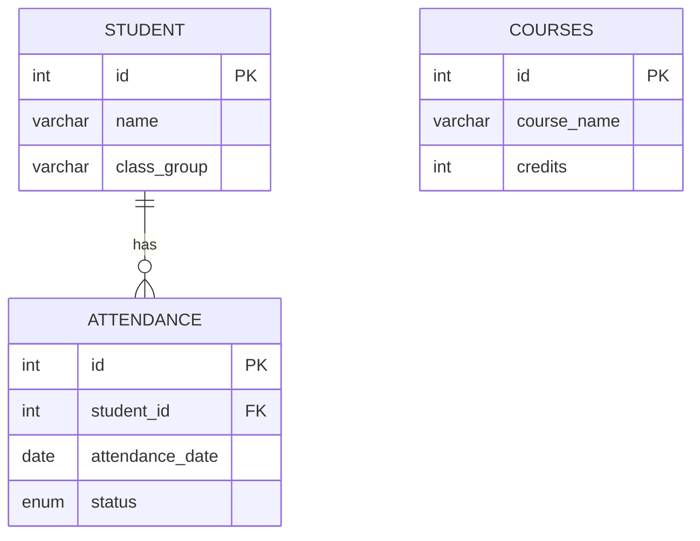

# Database design

The database is named `school_management`. The workshop specifies the courses table and assumes existing student and attendance tables. Since their lecture definitions were not provided, this project supplies minimal compatible definitions for a self-contained exercise.

The SQL uses lowercase table names. A student may have zero or many attendance records; each attendance record belongs to one student. The unique constraint on student ID and date prevents two attendance records for the same day. Status is restricted to Present or Absent. Courses are independent because the exercises do not ask for enrolment relationships.

All data is fictional. No credentials are stored in this project.
